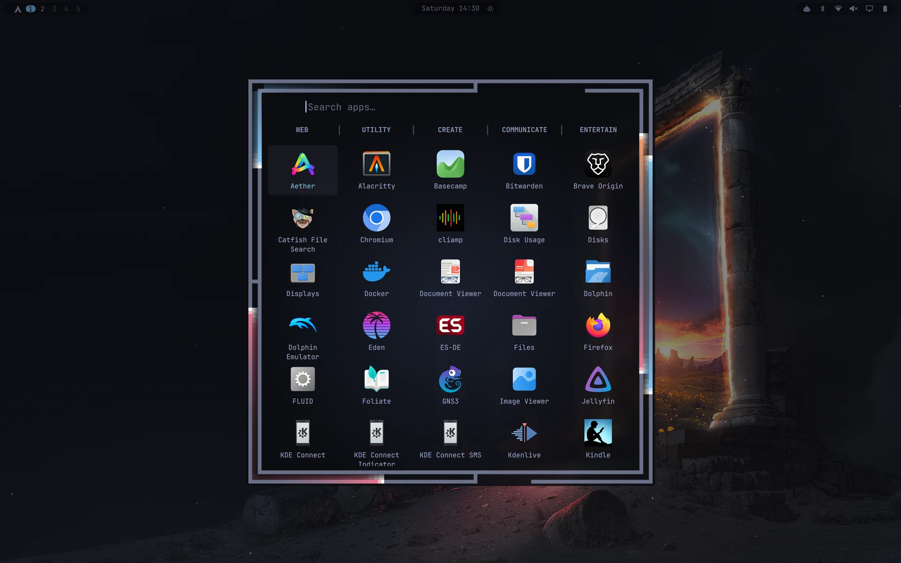
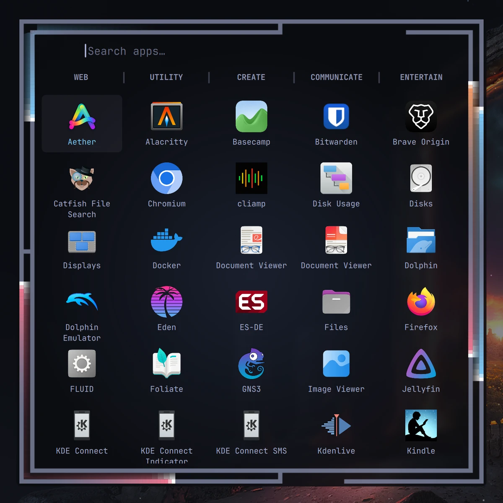
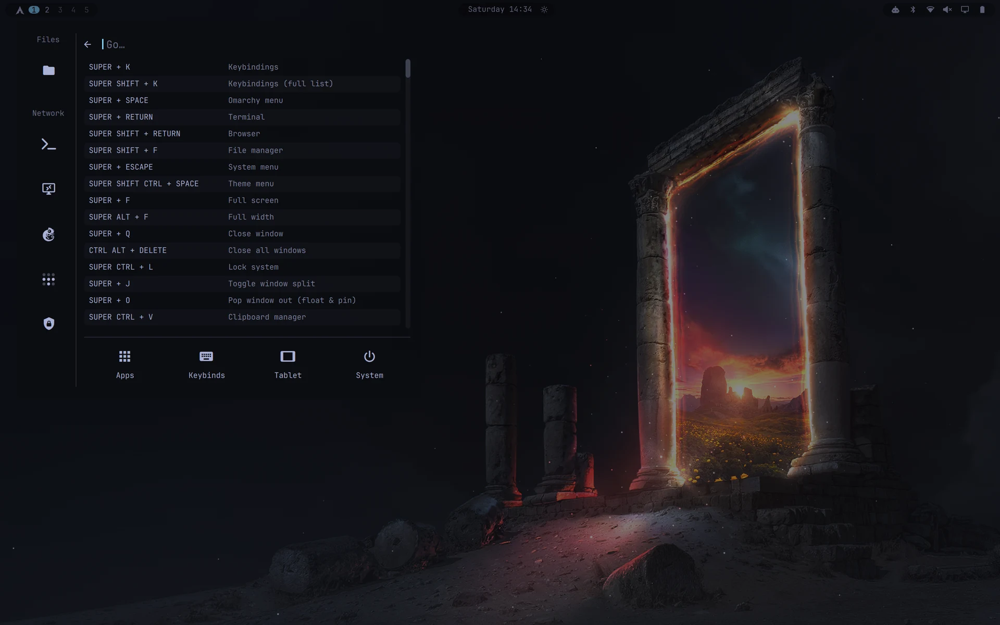
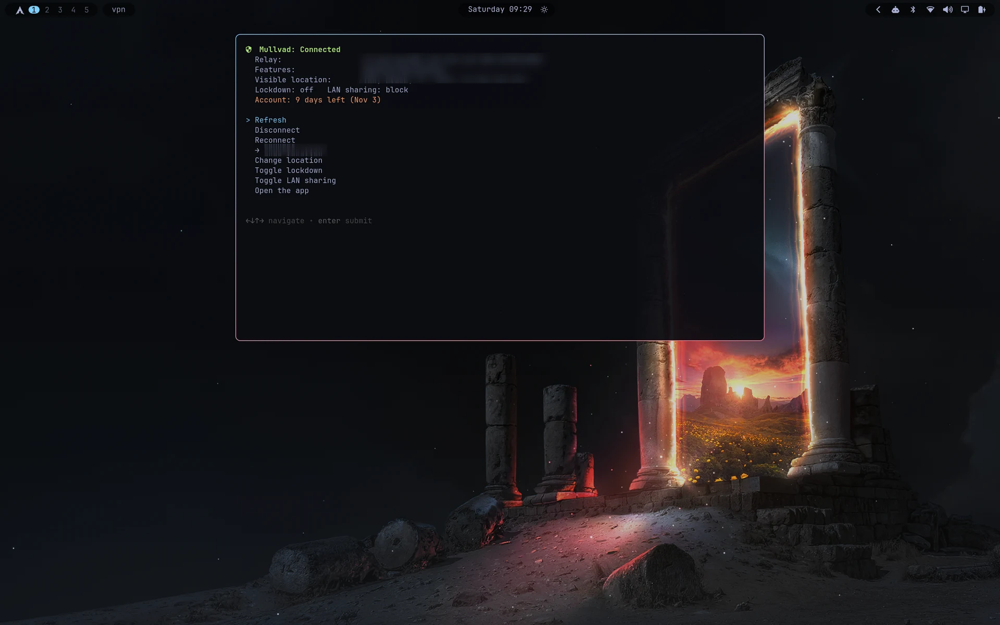
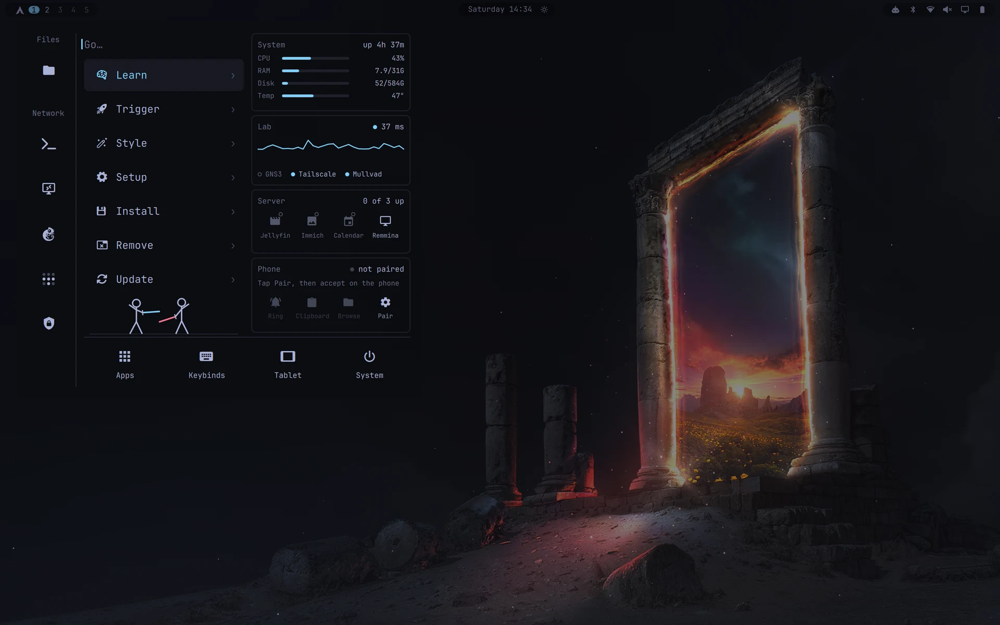
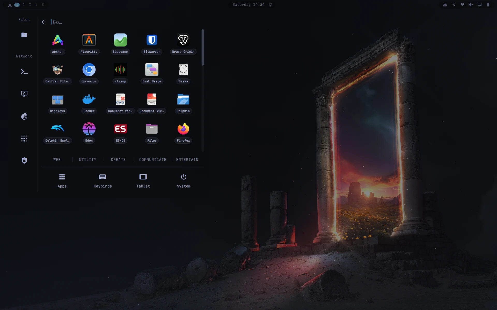
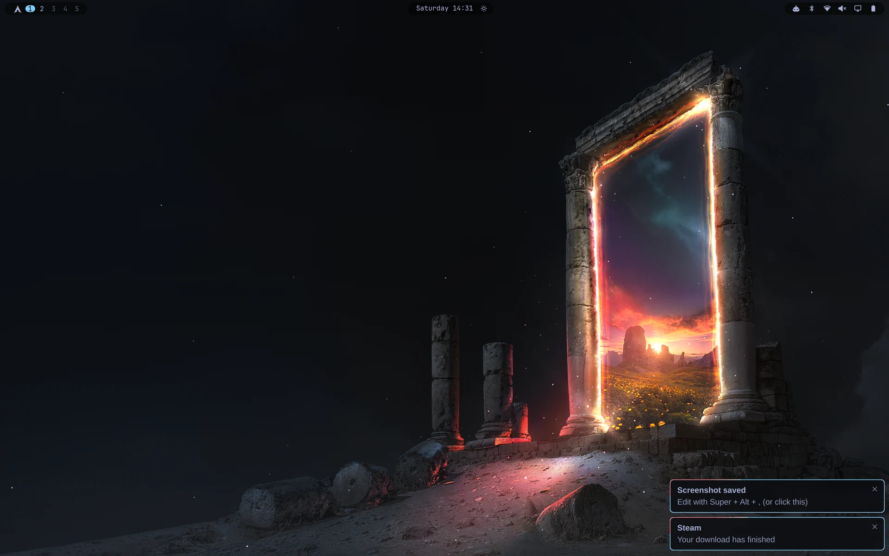
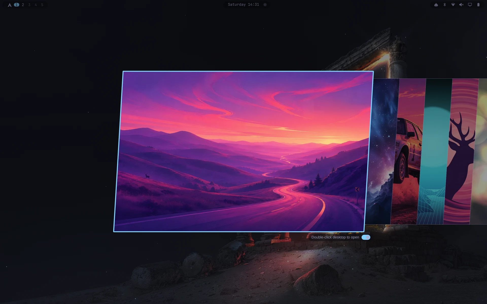
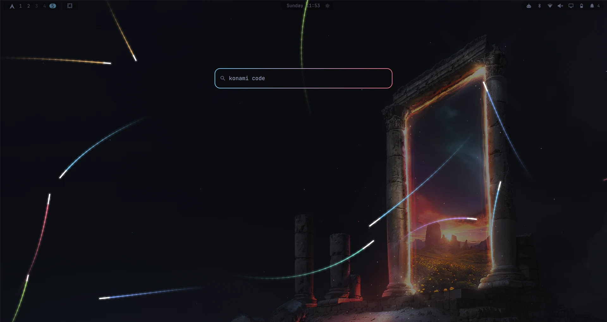

# Mullet Claude

**Business up front, party in the back.**

Omarchy on the Lenovo Yoga 9 2-in-1: a desktop and a tablet, built with
Claude.

A customised [Omarchy](https://omarchy.org) (Arch + Hyprland) setup for the
**Lenovo Yoga 9 2-in-1 14IPH11** (Intel Panther Lake, OLED touchscreen, pen).
Unfolded it's a polished desktop (the business). Fold the screen back and it
turns into a touch-first tablet (the party), with its own bar, launcher,
gestures, on-screen keyboard and auto-rotation.

Everything is user config. **Nothing under `/usr/share/omarchy` is modified**,
so `omarchy update` won't overwrite it. Built on Omarchy 4.0.x with Hyprland's
Lua config.

> Plugin ids start with `daa.`, which is just the local username (Omarchy's
> `plugin clone` prefixes clones with it). Rename freely.

---

## Contents

- [Screenshots](#screenshots)
- [Repo layout](#repo-layout)
- [Desktop mode](#desktop-mode)
- [Tablet mode](#tablet-mode)
- [Shared pieces](#shared-pieces)
- [Theming Qt, KDE and Catfish](#theming-qt-kde-and-catfish)
- [Hardware fixes for the Yoga 9 14IPH11](#hardware-fixes-for-the-yoga-9-14iph11)
- [File map](#file-map)
- [Installing](#installing)
- [Known quirks](#known-quirks)
- [License](#license)
- [Mullet Claude](#mullet-claude)

---

## Screenshots

### Tablet (the party)

| | |
|---|---|
|  Tablet mode, nothing open |  Tablet menu with its shortcut sidebar |  Touch app grid |
|  Quick toggles |  Workspace switcher |
|  Orientation picker (hold the rotate button to lock in place) |  On-screen keyboard over the launcher |
|  Rnote for the pen |  Portrait: the bar follows the panel's right edge |

---

### Desktop (the business)

| | |
|---|---|
|  App launcher (`SUPER + R`) framed by the Omarchy logo |  Theme based comets traverse Omarchy frame (toggle-able & adjustable) |  Terminal dropdown (`SUPER + T`) with the fastfetch greeting |  Keybindings (`SUPER + K`) in the Go menu: searchable, click to run |  System menu (`SUPER + ESCAPE`), bottom-left for touch |
|  Go menu (`SUPER + SPACE`): typing offers a whole-drive Catfish search |  Info bar (tap `SUPER`): workspaces and their apps, time, weather, status and a quote |  Workspace number flash, used when while the bar is hidden |  Display popup: refresh rate, toggles, brightness with a boost button |  Battery popup: four power profiles, each with its refresh rate |  Wi-Fi popup: Quad9 DNS and Mullvad / Tailscale toggles |  Mullvad in a terminal dropdown (`SUPER + M`) |
|  Go menu, (duelists occasionally active)  |  Go menu → Apps: the app grid in the menu's own space |
|  Notifications: bottom-right, × to dismiss, countdown border |  Wallpaper picker: added two-finger scrolling and and toggle for double click desktop activation|  KC4C search menu (tap `SUPER`) *"A bloody good time."* — raves Basil Fawlty  |  

## Repo layout

The folders mirror the home directory: `config/` is `~/.config` and `local/`
is `~/.local`. So `config/hypr/dropdowns.lua` lives at
`~/.config/hypr/dropdowns.lua`, and `local/bin/tablet-mode` at
`~/.local/bin/tablet-mode`. `system/` holds the few root-owned files, at
their paths from `/`.

---

## Desktop mode

### The bar (`daa.desktop-bar`)
A clone of Omarchy's bar, restyled as floating translucent "islands" with
blur behind them.

- **Left:** Arch logo (turns cyan on hover, click opens the Go menu,
  right-click opens a terminal), workspace dots, and an **app-name island**.
  Hover the app-name island for a list of every window per workspace,
  scratchpads included, and click one to jump to it.
- **Omarchy logo island** (`daa.desktop-shortcuts`), between the workspaces
  and the app name: hover and the box-shaped island grows, a stem drops out
  of it and a card of shortcuts blooms from the stem (apps on top; terminal,
  Tailscale, remote desktop and Mullvad bottom left; Home / Documents /
  Downloads bottom right). Light trails run round the whole island + stem +
  card outline. Shortcuts with a dropdown open it (folders open in the Files
  dropdown); the card closes 0.3 s after the pointer leaves it.
- **Middle:** a **now-playing island** that only appears while media is
  playing. It lingers 5 s after playback stops.
- **Centre:** the clock island and the weather. Toggles that are on show as
  small icons next to the clock (`daa.desktop-indicators`). The toggles
  themselves live as chips in the matching popups: Do not disturb and
  Dictation in the sound popup, Night light, Stay awake and Screen recording
  in the display popup, Reminder in the calendar.
- **Right:** system icons. **Popups open on hover**, no click needed, and
  sliding along the bar switches between them. Clicks do something else:

  | Icon | Left click |
  |---|---|
  | Claude usage (`daa.agents`) | Toggles the Claude Code dropdown |
  | Speaker (`daa.audio`) | Mute / unmute |
  | Display (`daa.monitor`) | Opens `wdisplays` (floating) |
  | Weather (`daa.weather`) | Toggles the GNOME Weather dropdown |
  | Battery, Wi-Fi, Bluetooth | Opens / closes the popup, as before |
  | Updates (`daa.updates`, left end) | Toggles the update dropdown (see below) |
  | Bell (`daa.notify-bell`, right end) | Slides in every notification (also on hover) |

  A click that closes a popup keeps it shut until the cursor leaves the icon
  and comes back, so it doesn't instantly hover open again.
- **Popups with extras:**
  - **Wi-Fi** (`daa.network`): a **VPN** row with Mullvad and Tailscale
    toggles (each only shows if installed), and a **Quad9** DNS option next
    to Omarchy's DHCP / Cloudflare / Google / Custom.
  - **Display** (`daa.monitor`): the current refresh rate (and whether it's
    adaptive) in the header, a note that the power profile sets it, and a
    **Boost** button under the brightness slider (see below).
  - **Battery** (`daa.power`): four power profiles instead of three.
- **Update count** (`daa.updates`): pending repo + AUR updates
  (`checkupdates`, `yay -Qua`) beside the icon; hidden at 0, white up to 20,
  cyan up to 30, then a slow coral blink. Rechecked every 30 minutes and as
  soon as an update run finishes.
- **Notification bell** (`daa.notify-bell`): the count of toasts on screen
  plus history beside it, still up to 5, pulsing cyan past 5 and coral past
  10. Its panel slides in from the right with every notification: click one
  to run its action (or focus its app), × to drop it, **Clear all**. Toasts
  stay up 10 s and history keeps 50.
- System stats (CPU, RAM, disk, temperature, uptime, internet latency) moved
  into the Go menu.
- **Tray** (`daa.tray`): the hidden-icons drawer takes no room while
  collapsed. Omarchy's tray kept a gap for every hidden icon, so the bar grew
  with each tray app.
- Turned off on purpose: dragging the bar to another screen edge, drag
  re-ordering widgets, and double-click to toggle transparency. All three
  were too easy to hit by accident.

### Look and feel
- All bar popups (calendar, weather, audio, network…), the volume and
  brightness pop-ups, and tooltips are **borderless**. The Go menu is too.
- **Tokyo Aura Midnight** (`config/omarchy/themes/tokyo-aura-midnight/`): Tokyo
  Night with near-black backgrounds and a cyan accent, as its own theme (stock
  Tokyo Night is left alone), and a cyan→coral gradient window border.
- **Touchpad scrolling that feels like GNOME, or better** (`TouchScroll.qml`)
  in the launcher, Go menu, Apps and Keybinds panels and clipboard: moves with
  the desktop's direction at 3.5× finger travel, coasts after you lift off,
  fingers back down brake it, and the ends flash a cyan edge glow. (Qt treats a
  touchpad scroll as a finger drag with no momentum, so this takes it over.)
- **Sublime Text** follows the theme too: a colour scheme template, near-black
  tab strip and see-through command palette (`Ctrl + P`).
- Tuned gaps so windows line up with the floating bar.
- **Notifications** (`daa.notifications`): bottom-right, fly in from the
  corner, stay 30 s (hover pauses), an × or `SUPER + Z` dismisses, and the
  border counts down: a white-headed pink line runs clockwise from 9 o'clock.
- Nautilus: Backspace goes back a folder, via a small nautilus-python
  extension (`local/share/nautilus-python/extensions/backspace_back.py`).
- Screensaver dims the OLED to 20% and restores 80% on exit.
- **Closing the lid doesn't suspend** (logind `HandleLidSwitch=ignore`), so
  downloads and Wi-Fi keep going. `lid.lua` turns the panel off while it's
  shut, and `~/.local/bin/lid-battery-guard` (a user service) suspends only
  when the lid is shut, the charger is out and the battery is at 20% or less.

### Login screen
Login screen design from [Infinity-Plasma-Themes](https://github.com/L4ki/Infinity-Plasma-Themes)
by L4ki, rebuilt in plain QtQuick without Plasma, with a user switcher.

- Galaxy background, clock, round avatar, password pill and Sleep / Restart /
  Shut Down, like the original, but with no `plasma-workspace` dependency.
- **‹ name ›** above the password: ← → ↑ ↓ or Tab (or the arrows) pick the
  account. Omarchy's own login screen only ever logs in the last user.
- Theme: `system/usr/share/sddm/themes/infinity-omarchy/`, selected by
  `system/etc/sddm.conf.d/99-zz-theme.conf` (SDDM lets the last file win, and
  Omarchy's `99-omarchy-login.conf` also sets one).
- That folder is **GPL-3.0+**, like the original, and ships its license. The
  4K background isn't copied here: grab `background.jpg` from
  [L4ki's Infinity-SDDM](https://github.com/L4ki/Infinity-Plasma-Themes/tree/main/Infinity-SDDM).
  See the folder's README.

### Shared guest account
A second login (`guest`) for letting other people use the laptop (GNS3 and
Tailscale for a network lab) with no admin rights and no access to your files.
It gets a copy of this desktop minus browsers, password manager, git
identity, phone pairing, remote-desktop profiles and AI tools; the Go menu
spots it by `$USER` and shows only GNS3, Tailscale and Mullvad (terminal
version only) with the server and phone cards greyed out. Whoever clicks the
Tailscale toggle becomes its operator (`tailscale-claim`). Autologin is off,
and the login screen's ‹ › switcher picks the account.

### Quick search and info bar (tap `SUPER`)
A tap of `SUPER` on its own (a release bind, so `SUPER` shortcuts don't
trigger it) dims the screen and drops a small search box near the top
(`daa.search`), with the **info bar** (`daa.infobar`) at the bottom middle.
Both have a slowly breathing cyan-to-coral border.

- **Search:** matching apps, then *Search files* (Catfish dropdown) and
  *Search the web*. `/` switches to commands (`/lock`, `/reboot`, `/update`,
  `/claude`, `/screenshot`, `/dnd`, `/clear`, …); anything else after `/`
  can run in a terminal. Up / Down move, Enter runs, Escape closes.
- **Tab / Shift + Tab** step through the workspaces while it's up; the box
  stays open. Opening an app or a dropdown closes it.
- **Info bar:** the workspaces in use with their app icons (click one to go
  there), time and date, weather and where it's for, and Wi-Fi, battery and
  Bluetooth (longest first). Click a status line and the cursor glides up to
  that bar icon and opens its popup (`~/.local/bin/cursor-to-tray`). A quote
  at the bottom changes every 6 hours.
- **Easter eggs:** the Konami code sets off a comet storm; `abacabb` turns
  the UI's cyans and whites to coral for a minute (and the Go menu duel ends
  rather more decisively).
- Quotes: `daa.infobar/quotes.txt`, one per line, edited live.
- Data: `~/.local/bin/infobar-status` prints one JSON snapshot per show.
  Weather comes from wttr.in for the location saved with
  `omarchy-weather-location --set "<town>" <lat>,<lon>`; going by IP, it
  followed the VPN's exit server instead.
- **Workspace flash:** while the bar is hidden, switching workspaces (swipe
  or keys) flashes the workspace number mid-screen, with a dot per
  workspace.

### Power profiles, refresh rate and brightness
The OLED does 48–120 Hz with adaptive sync. `~/.local/bin/power-refresh`
ties a refresh rate to each power profile and adds a fourth profile:

| Profile | power-profiles-daemon | Refresh |
|---|---|---|
| Saver | power-saver | 60 Hz |
| Balanced | balanced | 60 Hz |
| **Less balanced** | balanced | 120 Hz, adaptive (drops toward 48 Hz when idle) |
| Performance | performance | 120 Hz fixed |

Like Omarchy's profiles, the choice is remembered separately for charger
and battery, so unplugging can drop you to 60 Hz on its own. Battery choices
last one session: each login starts on battery at Less balanced. Unplugged at
30% or less, Less balanced and Performance drop to Balanced (60 Hz) once per
discharge, with a notification. A small watcher
(`power-refresh watch`, started from `autostart.lua`) re-applies the rate
when the profile or power source changes, so Omarchy's own menu and
`powerprofilesctl` still work. Startup (`monitors.lua`) and tablet rotation
use the current rate.

**Brightness** (`~/.local/bin/brightness-step`): the panel's very top raw
step is a much brighter jump than anything below it, so 100% is set just
under it, and the steps get finer near the top:

| Keys | Action |
|---|---|
| Brightness up / down | 100 → 98 → 96 → 94 → 92 → 90, then 85 → 80 → … → 5 → 1 |
| `SHIFT` + up / down | Boost (the panel's real maximum) / minimum |
| `ALT` + up / down | ±1% |

The display popup's slider uses the same scale, its **Boost** button toggles
the top step, and login never starts in boost. External monitors keep
Omarchy's normal steps.

### Dropdown apps (`~/.config/hypr/dropdowns.lua`)
One key summons an app that slides down from the top. The same key hides it
again. Every dropdown is preloaded hidden at login, so the first press is
instant. Scripts and menus can summon one too:
`hyprctl eval 'dropdown_show("files")'` (or `dropdown_toggle`).

| Key | App |
|---|---|
| `SUPER + T` | Terminal (Alacritty) |
| `SUPER + C` | Claude Code (in Ptyxis for kinetic touchpad scrolling; header bar hidden above the screen) |
| `SUPER + I` | btop |
| `SUPER + E` | Files (Nautilus); also the tablet menu's and app grid's Files buttons |
| `SUPER + P` | Bitwarden, pinned to the top-right corner and sliding in from the right |
| `SUPER + D` | Catfish file search over the whole drive (`/`, not just home) |
| `SUPER + ALT + W` | GNOME Weather; also a left click on the bar's weather |
| `SUPER + M` | Mullvad in a terminal (`~/.local/bin/mullvad-tui`): status, account days left, connect, quick-connect to custom lists and recent locations, a searchable location picker |
| (bar update count) | `omarchy-update`, pinned to the top-right corner and sliding in from the right; not preloaded, since it would start updating at login |
| `SUPER + SHIFT + M` | The Mullvad app, rising from the bottom (`rise = 1 / 3`). It only runs while it's shown: hiding it quits it (`quit_on_hide`), since it crash-reported when logout killed it |

Each entry can set its size (`px` or screen fractions), pin itself to the
right edge (`right = 10`) and pick its own slide direction (`slide =
"slide"` comes in from the right). `rise = 1 / 3` makes one come up from the
bottom instead and rest with its centre a third of the way up: special
workspaces can only slide in from the top or the side, so those skip the
workspace animation and move the window itself. Hyprland can't give one special workspace
its own animation through workspace rules, so the style is switched just
before each toggle. `dropdown_relaunch(name, args)` restarts a dropdown with
extra arguments, which is how the menu's file search opens Catfish already
searching.

### Menus
- **Go menu** (`SUPER + SPACE`, Arch logo): swings in from a hinge at its
  top-left corner. A dashboard column holds a **Lab** card (VNC status of a
  lab box; set `LAB_PROFILE` to your Remmina profile), a **Server** card
  (services from `~/.config/lab-services/services`), a **System** card (CPU,
  RAM, disk, temperature, uptime; click for btop) and a **Phone** card (KDE
  Connect). The cards bounce in from the left, the sidebar icons sag and spring
  back like a slinky, and the footer buttons (Apps, Keybinds, Tablet, System)
  are dealt out like cards. **Apps** turns the menu's space into an app grid
  with the launcher's categories; **Keybinds** shows every binding, searchable,
  and a click runs it (right-click opens `bindings.lua` in Sublime). Tab walks
  the footer. Try `SUPER + CTRL + ALT + SPACE` for the version without brakes,
  and look out for the duel under Update (1 in 12, or type `omarchy!`). The
  **Lab** card's heartbeat is a `tailscale ping` to the lab box (latency and
  whether the route is direct or via a DERP relay); the **System** card adds
  internet latency.
- **Keybindings** (`SUPER + K`): opens the Go menu on its Keybinds panel;
  `SUPER + SHIFT + K` is the big standalone list.
- **App launcher** (`SUPER + R`): a square 5 × 6 grid framed by the Omarchy
  logo, drawn to scale from the logo's 13 × 13 grid. Light trails start at the
  logo's seven entrances, lead white, then cyan, coral or one rotating Tokyo
  Night colour, glow into the channel between the lines, and never jump a gap.
- **Password dialog** (`daa.polkit`): rises from the bottom and rests a third
  of the way up. The speakers don't work yet, so it also **spins the fans
  up** (`~/.local/bin/attention-fans`: half the cores busy, at most 20 s,
  stopped as soon as the dialog closes) to get your attention.
- **System / power menu** (`SUPER + ESCAPE`, power button): borderless, in the
  bottom-left corner, sliding in from the left. Escape is top-left on the
  keyboard, so the options are a short reach away on the touchscreen.
- **Clipboard** (`SUPER + V`, `daa.clipboard`): borderless, middle of the left
  edge, slides in from the left, with a **Clear all** button (asks first; same
  as `Shift + Delete`).
- **Re-press to close, other key to switch.** Every menu key goes through
  `~/.local/bin/menu-toggle`: pressing a menu's own key closes it, and
  pressing another menu's key switches straight to that menu. `daa.menu`
  records what it's showing in `$XDG_RUNTIME_DIR/omarchy-menu-open`. It also
  releases a script-driven list (like the keybindings list) when another
  menu replaces it, instead of leaving the script waiting forever.
- **File search from the Omarchy menu.** Type in the menu (`SUPER + SPACE`)
  and the last result row offers *Search all files* for what you typed. It
  runs `~/.local/bin/file-search`, which drops Catfish down already searching.

### Scratchpad behaviour (`~/.config/hypr/scratchpads.lua`)
- Clicking anywhere outside a scratchpad or dropdown hides it. So does
  focusing another window, or `SUPER + X`. Clicks while a screenshot region
  is being picked, or in the quick search / info bar, don't count.
- Whenever a scratchpad or dropdown shows, the cursor moves to its centre.
- New windows opened while a scratchpad is showing land on the normal
  workspace underneath, not inside the scratchpad.
- Guards stop double-clicks and closing bar panels from bringing a hidden
  scratchpad back (see [Known quirks](#known-quirks)).
- Hovering a bar popup open while a scratchpad is showing keeps the
  scratchpad on screen, dimmed, until the popup closes. Summoning a dropdown
  (click or key) while a popup is open closes the popup instead: whatever
  you did last on purpose wins.
- Every show / hide and guard decision is logged to
  `~/.local/state/scratchpad-debug.log` while a rare pop-up bug is chased.

### Workspaces (`~/.config/hypr/workspace_collapse.lua`)
Workspaces stay packed from 1. When one empties, the ones after it shift
down, and focus follows.

**Magellanic desktop selection** (`SUPER + ALT + number`): go to a workspace
the long way round. The bar's workspace indicator heads *away* from it, laps
the whole top bar, wraps at the screen edge and lands on it from the other
side. If the focused window is in a window group, the same keys pick that
group's tab instead (Omarchy's own use of them).

---

## Tablet mode

Folding the screen past 180° flips the **Lenovo Yoga Tablet Mode Control
switch**. Hyprland (`~/.config/hypr/tablet_mode.lua`) runs
`~/.local/bin/tablet-mode on`, and unfolding runs `tablet-mode off`. The
same script backs the tablet menu and buttons.

### What switching on does
- Turns off the keyboard and touchpad.
- Swaps the desktop bar for a separate **tablet bar** (`daa.tablet-bar`),
  50% bigger, pinned to the panel's physical right edge whichever way it's
  rotated.
- Starts **edge-swipe gestures** (lisgd), the **on-screen keyboard** (wvkbd,
  pops up on text fields) and **auto-rotation** (iio-sensor-proxy). Finger
  and pen input are remapped to match each rotation.
- Switches to **tablet-mode colours**: coral accent, borderless menus and
  notifications.
- Switches to the **tablet wallpaper**. Each mode remembers its own
  wallpaper: whatever you pick while in a mode sticks to that mode.

Unfolding puts everything back exactly as it was.

### The tablet bar
| Button | Tap | Hold |
|---|---|---|
| Arch logo | Tablet menu | |
| Apps | Touch app grid (4 columns, list in `~/.config/tablet-mode/apps`); its **File browser** button drops Files down like `SUPER + E` | |
| Workspace number | Workspace and window switcher (close windows with ✕, hide scratchpads) | |
| Keyboard | Show / hide the on-screen keyboard | |
| Rotate | Toggle the rotation lock (stays coral while locked) | Pick an orientation |
| Quick toggles | Screenshot, Screenshot area, **Wallpaper**, Do not disturb, Night light, Stay awake, Recording, Reminders | |
| Play / pause | Media | |

- Buttons light up when tapped and fade back after about a second, since a
  finger never "un-hovers".
- Scroll rails in menus, the launcher and the app grid sit on the
  **thumb side** (nearest screen edge). The handle lights up coral while
  you drag it.

### Gestures (`~/.config/tablet-mode/gestures`)
| Gesture | Action |
|---|---|
| Swipe down from the top edge | Tablet menu |
| Swipe up from the bottom edge | On-screen keyboard |
| Swipe in from the left edge | App launcher |
| Swipe in from the right edge | Close the focused window |
| Three-finger swipe left / right | Next / previous workspace |

### Tap the wallpaper to tidy up
A single tap on empty wallpaper (`daa.background`) runs `tablet-mode dismiss`.
That hides the keyboard, scratchpads, menus, launchers, bar popups and the
tray drawer. In tablet mode, double-tapping the wallpaper no longer opens the
wallpaper picker; use the Quick toggles button instead.

### Reading
Papers for PDFs, Foliate for EPUB and comics, Komikku as a comic library,
Kindle as a web app, Rnote, Xournal++ and Krita for the pen.
`~/.local/bin/comic-open` opens CBZ files straight in Foliate and repacks
CBR to CBZ first. CBR needs `unrar`.

---

## Shared pieces

These work in both modes and adapt to tablet mode on their own:

| Plugin | Role |
|---|---|
| `daa.menu` | Every menu: Go menu, tablet menu, Quick toggles, workspace switcher. Opens against the bar, has a touch back-arrow and a shortcut sidebar (Home, Documents, Desktop, Screensaver, Log out, Shut down) |
| `daa.launcher` | App launcher framed by the Omarchy logo, touch scrolling, a scroll rail in tablet mode |
| `daa.osd` | On-screen display |
| `daa.background` | Wallpaper renderer, plus tap-to-dismiss in tablet mode |
| `daa.clipboard` | Clipboard manager: borderless, left edge, Clear all button |
| `daa.polkit` | Password dialog: rises from the bottom, spins the fans up while waiting |
| `daa.tray` | System tray whose collapsed drawer takes no room |
| `daa.infobar` | Info bar on a tap of `SUPER`, plus the workspace flash |
| `daa.network` | Wi-Fi popup with VPN toggles and Quad9 DNS |
| `daa.power` | Battery popup with four power profiles |
| `daa.monitor` | Display popup: refresh rate, toggles, brightness and boost |
| `daa.audio` | Sound popup; left click on the icon mutes |
| `daa.agents` | Claude usage; left click toggles the Claude Code dropdown |
| `daa.weather` | Weather; left click toggles the GNOME Weather dropdown |
| `daa.clock` | Clock and calendar popup (with the Reminder chip) |
| `daa.notifications` | Notifications: bottom-right, 30 s, × to dismiss, countdown border |
| `daa.image-picker` | Wallpaper / theme picker with touchpad scrolling and a double-click toggle |

---

## Theming Qt, KDE and Catfish

Everything follows the Omarchy theme and is regenerated on every theme change
through Omarchy's own template system (`~/.config/omarchy/themed/*.tpl`) and a
`theme-set` hook.

**Qt and KDE apps** (Dolphin, Kdenlive…):
- `QT_QPA_PLATFORMTHEME=qt6ct` (set in `looknfeel.lua`; Omarchy's default
  is `gtk3`, which gives KDE apps little more than light or dark), with the
  Breeze style. Needs `qt6ct` and `breeze`.
- `themed/kde.colors.tpl` is a KDE color scheme and `themed/qt6ct-colors.conf.tpl`
  a qt6ct palette, both mapped from the theme's named colors. Sidebars and
  toolbars use the darker `dark_background`, file views the normal
  `background`, like Nautilus.
- `hooks/theme-set.d/kde-qt-theme` merges the scheme into `kdeglobals`, links
  it as the "Omarchy" color scheme, writes `qt6ct.conf`, and pre-selects
  Omarchy in each installed KDE app's own settings (KDE apps read their scheme
  choice from their own rc file, not `kdeglobals`).
- It also builds a small `Omarchy-Qt` icon theme on top of the Omarchy one:
  light outline icons for Dolphin's Places sidebar (Breeze's, recoloured to
  the theme foreground, since KDE only recolours icons on Plasma), with
  `breeze-dark` or `breeze` filling the gaps to match light or dark themes.
- Tip: Dolphin won't accept an empty name for a Places entry, but a
  zero-width space works, giving icon-only entries.

**Catfish** is GTK 3. It gets its own theme, `Omarchy-Catfish`
(`themed/catfish-gtk3.css.tpl`, dark Adwaita plus Dolphin-style colours),
and only the `SUPER + D` dropdown launches it with
`GTK_THEME=Omarchy-Catfish`. Other GTK apps are untouched. (GTK 3 only lets
CSS target a window by name if the app sets one, and Catfish doesn't.)

---

## Hardware fixes for the Yoga 9 14IPH11

| Problem | Fix |
|---|---|
| **Brightness keys do nothing.** The OLED wants DPCD AUX backlight; the firmware says PWM. | Kernel option `xe.enable_dpcd_backlight=1` (Limine: drop-in in `/etc/limine-entry-tool.d/`, then `sudo limine-update`). |
| **No rotation sensor.** ISH firmware is rejected. | Use the Yoga's own signed ISH firmware from its Windows install (DriverStore `ishheciextensiontemplate.inf_*/FwImage/0004/PTL_ishS_SI.bin`), installed as `/lib/firmware/updates/intel/ish/ish_ptl_<crc32 of "83SE">_<vendor crc>.bin.zst`. **Extract your own copy; don't redistribute the blob.** |
| **5% brightness steps look uneven at the top.** The panel's top raw step (4095) is a much brighter jump than the one below it. | `brightness-step` puts 100% at raw 4054 and keeps the top step as "boost". |
| **Stuck at 60 Hz.** The panel reports 60 Hz as preferred but does 48–120 Hz with adaptive sync. | Ask for `highrr`; per-monitor `vrr` is ignored on Hyprland 0.56, `misc.vrr` works (`power-refresh`). |
| **PrtSc does nothing.** The key sends `XF86SelectiveScreenshot`. | Bind that keysym to `omarchy-capture-screenshot region`. |
| **No speakers ("Dummy Output").** A ghost SoundWire device. | Fixed upstream in kernel **7.3** ("soundwire: dmi-quirks: add a global ghost list"). Waiting for Omarchy's 7.3 kernel. |
| **Windows not in the Limine menu.** It's on a separate ESP. | Add a manual `/Windows` EFI chainload entry to `/boot/limine.conf`. |

---

## File map

**Desktop only** (`daa.desktop-*`): `daa.desktop-bar`,
`daa.desktop-arch-menu`, `daa.desktop-workspaces`, `daa.desktop-app-name`,
`daa.desktop-media`, `daa.desktop-indicators`.

**Tablet only** (`daa.tablet-*`): `daa.tablet-bar`, `daa.tablet-menu`,
`daa.tablet-workspace`, `daa.tablet-apps`, `daa.tablet-apps-grid`,
`daa.tablet-keyboard`, `daa.tablet-rotate`, `daa.tablet-quick`,
`daa.tablet-media`.

**Shared:** `daa.menu`, `daa.launcher`, `daa.osd`, `daa.background`,
`daa.clipboard`, `daa.polkit`, `daa.tray`, `daa.infobar`, `daa.network`,
`daa.power`, `daa.monitor`, `daa.audio`, `daa.agents`, `daa.weather`,
`daa.clock`, `daa.notifications`, `daa.image-picker`.

| Path | Mode | Purpose |
|---|---|---|
| `~/.config/omarchy/plugins/` | both | Shell plugins above (also has its own `README.md` map) |
| `~/.config/omarchy/shell.json` | both | Bar layout and enabled plugins |
| `~/.config/omarchy/shell.toml` | both | Theme overrides (borderless popups and tooltips) |
| `~/.config/omarchy/extensions/omarchy-menu.jsonc` | both | Menu entries (`tablet.*` = tablet) |
| `~/.config/omarchy/themed/` | both | Theme templates: GTK, Firefox, KDE, qt6ct, Catfish, shell |
| `~/.config/omarchy/themes/tokyo-aura-midnight/` | both | Tokyo Aura Midnight: near-black Tokyo Night with a cyan accent (add your own `backgrounds/`) |
| `~/.config/sublime-text/Packages/User/`, `themed/*.sublime-*.tpl` | both | Sublime Text theme, `Ctrl + P` palette, no tab arrows |
| `~/.config/omarchy/hooks/theme-set.d/kde-qt-theme` | both | Applies the Qt/KDE theme on every theme change |
| `~/.local/bin/menu-toggle` | both | Menu keys: re-press closes, other key switches |
| `~/.local/bin/file-search` | both | Opens the Catfish dropdown searching for its arguments |
| `~/.local/bin/attention-fans` | both | Spins the fans up while the password dialog waits |
| `~/.config/hypr/lid.lua`, `~/.local/bin/lid-battery-guard`, `~/.config/systemd/user/lid-battery-guard.service` | both | Lid closed: panel off, suspend only on low battery |
| `~/.local/bin/power-refresh`, `~/.config/hypr/monitors.lua`, `autostart.lua` | both | Power profile → refresh rate / adaptive sync |
| `~/.local/bin/brightness-step` | both | Brightness keys, slider scale and boost |
| `~/.local/bin/infobar-status` | both | JSON for the info bar |
| `~/.local/bin/mullvad-toggle` | both | Wi-Fi popup's Mullvad toggle (opens the app when logged out) |
| `~/.local/bin/mullvad-tui` | both | Mullvad in a terminal (`SUPER + M`) |
| `~/.local/bin/keybind-run` | both | Runs a keybinding picked in the Go menu's Keybinds panel |
| `~/.local/bin/firefox-theme-link` | both | Links the themed Firefox CSS into every profile at login |
| `~/.local/bin/tailscale-toggle`, `system/usr/local/bin/tailscale-claim`, `system/etc/sudoers.d/tailscale-claim` | both | Tailscale on/off for whoever is logged in (e.g. a shared guest account) |
| `system/usr/local/bin/omarchy-dns-quad9`, `system/etc/sudoers.d/omarchy-dns-quad9` | both | Quad9 DNS preset (DNS-over-TLS, Cloudflare fallback) and its password-free sudo rule |
| `~/.local/bin/lab-status` | desktop | Status line for the Go menu's lab card (set `LAB_PROFILE` to your Remmina profile) |
| `~/.config/hypr/dropdowns.lua`, `scratchpads.lua`, `workspace_collapse.lua`, `screensaver_brightness.lua`, `looknfeel.lua`, `bindings.lua` | both | Hyprland behaviour |
| `~/.config/hypr/tablet_mode.lua` | tablet | Fold switch → `tablet-mode on/off` |
| `~/.local/bin/tablet-mode` | tablet | The switcher (run with no arguments for usage) |
| `~/.config/tablet-mode/gestures`, `apps` | tablet | Gestures and the app-grid list |
| `~/.local/share/tablet-setup/setup-tablet.sh` | tablet | One-time package and permission setup |

---

## Installing

1. Install Omarchy, and check that `hyprctl version` reports a Lua-config
   Hyprland.
2. Copy the folders above into place. If your username isn't `daa`, rename
   the `daa.*` plugin folders, the ids inside their `manifest.json` files,
   and the ids in `shell.json`, all to match.
3. Tablet extras: run `setup-tablet.sh`. It installs `iio-sensor-proxy`,
   `lisgd` and `wvkbd` (AUR), the reading and drawing apps, and adds you to
   the `input` group. Log out and back in afterwards.
4. Desktop extras: `qt6ct`, `breeze`, `catfish`, `bitwarden`, `wdisplays`
   and `gnome-weather` from the official repos.
   For the Quad9 option, install the helper root-owned and (optionally) the
   sudo rule with your username in place of `YOUR_USER`:
   `sudo install -m 0755 system/usr/local/bin/omarchy-dns-quad9 /usr/local/bin/`,
   then check the rule with `visudo -cf` and
   `sudo install -m 0440 system/etc/sudoers.d/omarchy-dns-quad9 /etc/sudoers.d/`.
5. Apply the hardware fixes your machine needs.
6. Run `omarchy restart shell`, then `hyprctl reload`, and re-apply your
   theme (`omarchy theme set "<theme>"`) so the templates and hook run.

The tablet bits are written for this model's device names (keyboard
`at-translated-set-2-keyboard`, Cirque touchpad, Wacom `wacom-hid-544c`
touch and pen, panel `eDP-1`). Change the variables at the top of
`tablet-mode` for other 2-in-1s.

---

## Known quirks

- **Clones don't get upstream updates.** The bars, menu, launcher, OSD,
  background and indicators are copies of Omarchy's built-ins. After big
  Omarchy updates, compare them with the originals in
  `/usr/share/omarchy/shell/` and port any fixes you want.
- **Dropdowns popping up after menus.** When a menu or bar popup closes,
  Hyprland gives focus back to the last focused window, and if that's in a
  hidden dropdown it shows it. `scratchpads.lua` parks focus on a regular
  window as a menu opens and, on an empty workspace where there's nothing to
  park on, hides any dropdown that appears unasked within half a second of a
  menu closing. It can still flash for a frame; everything is logged to catch
  what's left.
- **Hot reload goes stale.** Saving a plugin file sometimes leaves the old
  code running alongside the new (even a second copy firing its own
  pop-ups). `omarchy restart shell` fixes it.
- **Weather over a VPN.** wttr.in guesses the location from your IP, which is
  the VPN's exit server. Save your location with `omarchy-weather-location`.
- **Some indicator services can't be reached from a plugin.** Omarchy's idle
  service never resolves from the Stay awake chip, so it reads and writes the
  same state file as `omarchy toggle idle` instead.
- **No sound from the speakers yet.** The audio shows as "Dummy Output"
  because of a ghost SoundWire device. It's fixed upstream in kernel 7.3, and
  this machine is on 7.2, so it's waiting on Omarchy shipping a 7.3 kernel.
  (See the hardware table.) Until then the password dialog spins the fans up
  instead of beeping.
- **Shell log noise.** Swapping bars logs harmless `Cannot read property …
  of null` warnings while widgets unload. Omarchy's own panels do the same.
- **Comics.** Komikku can't open a file by path, so `comic-open` sends files
  to Foliate instead.
- **Bitwarden looks black in screenshots.** That's its screen-capture
  protection, not a rendering bug.
- **Dolphin's sidebar highlight** is solid accent for a moment after launch
  (and while clicking), because the Places panel has keyboard focus then.

---

## License

[MIT](LICENSE). Take whatever's useful.

Exception: the login screen theme
(`system/usr/share/sddm/themes/infinity-omarchy/`) is GPL-3.0+, as it's based
on L4ki's [Infinity-Plasma-Themes](https://github.com/L4ki/Infinity-Plasma-Themes).
Its own [LICENSE](system/usr/share/sddm/themes/infinity-omarchy/LICENSE)
applies there.

---

## Mullet Claude

Where it started: the original pen sketches for tablet mode, drawn in Rnote.
The touch app grid with its scroll bar and File browser / All apps buttons,
the tablet bar (workspace, Arch logo, keyboard, rotate, Omarchy toggles,
clock, tray), and the tablet menu with its Home / Docs / Desktop and
Screensaver / Log out / Shut down sidebar.

And the man himself:

  

